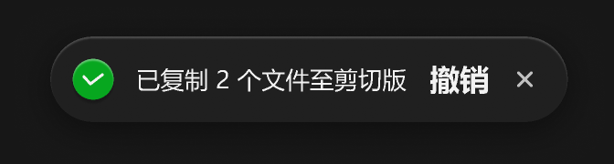
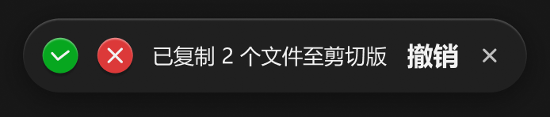

# 通知栏





失败和成功按需出现。

上→下位移出现。

不要挡到工具栏，定位在列表容器顶部居中。

``` css
/* 通知栏 */

/* Auto layout */
display: flex;
flex-direction: row;
justify-content: center;
align-items: center;
padding: 12px 16px 12px 12px;
gap: 12px;

position: absolute;
width: 312px;
height: 46px;

/* 通用/半透明-2 */
background: rgba(41, 41, 41, 0.5);
/* 立体感-模糊-大阴影 */
box-shadow: 0px 4px 20px rgba(0, 0, 0, 0.4), inset 0px 1px 1px rgba(255, 255, 255, 0.2);
backdrop-filter: blur(40px);
/* Note: backdrop-filter has minimal browser support */
border-radius: 99px;


/* 成功 */

/* Auto layout */
display: flex;
flex-direction: row;
justify-content: center;
align-items: center;
padding: 4px;

width: 22px;
height: 22px;

/* 状态/成功 */
background: #07A71F;
/* 立体感-主要按钮 */
box-shadow: 0px 2px 1px rgba(0, 0, 0, 0.2), inset 0px 1px 1px rgba(255, 255, 255, 0.4);
border-radius: 15px;

/* Inside auto layout */
flex: none;
order: 0;
flex-grow: 0;


/* 对勾-小-icon */

/* Auto layout */
display: flex;
flex-direction: column;
justify-content: center;
align-items: center;
padding: 0px;

width: 14px;
height: 14px;


/* Inside auto layout */
flex: none;
order: 0;
flex-grow: 1;


/* Vector 9891 */

width: 10px;
height: 5px;

/* 亮色/一级 */
border: 1.5px solid #F2F2F2;

/* Inside auto layout */
flex: none;
order: 0;
flex-grow: 0;


/* 失败 */

/* Auto layout */
display: flex;
flex-direction: row;
justify-content: center;
align-items: center;
padding: 4px;

width: 22px;
height: 22px;

/* 状态/禁止 */
background: #DC3939;
/* 立体感-主要按钮 */
box-shadow: 0px 2px 1px rgba(0, 0, 0, 0.2), inset 0px 1px 1px rgba(255, 255, 255, 0.4);
border-radius: 15px;

/* Inside auto layout */
flex: none;
order: 1;
flex-grow: 0;


/* 关闭-小-icon */

/* Auto layout */
display: flex;
flex-direction: row;
justify-content: center;
align-items: center;
padding: 0px;

width: 14px;
height: 14px;


/* Inside auto layout */
flex: none;
order: 0;
flex-grow: 0;


/* svg */

width: 8px;
height: 8px;


/* Inside auto layout */
flex: none;
order: 0;
flex-grow: 0;


/* Vector */

position: absolute;
left: 21.43%;
right: 21.43%;
top: 21.43%;
bottom: 21.43%;

/* 亮色/一级 */
border: 1.5px solid #F2F2F2;


/* 已复制 2 个文件至剪切版 */

width: 146px;
height: 18px;

/* 通用/正文 */
font-family: 'Microsoft YaHei UI';
font-style: normal;
font-weight: 400;
font-size: 13px;
line-height: 18px;
/* identical to box height, or 138% */

/* 亮色/一级 */
color: #F2F2F2;


/* Inside auto layout */
flex: none;
order: 2;
flex-grow: 0;


/* 撤销 */

width: 32px;
height: 22px;

/* 通用/按钮文字-大 */
font-family: 'Microsoft YaHei UI';
font-style: normal;
font-weight: 700;
font-size: 16px;
line-height: 22px;
/* identical to box height, or 138% */

/* 亮色/一级 */
color: #F2F2F2;


/* Inside auto layout */
flex: none;
order: 3;
flex-grow: 0;


/* 关闭-小-icon */

/* Auto layout */
display: flex;
flex-direction: row;
justify-content: center;
align-items: center;
padding: 0px;

width: 14px;
height: 14px;


/* Inside auto layout */
flex: none;
order: 4;
flex-grow: 0;


/* svg */

width: 7px;
height: 7px;


/* Inside auto layout */
flex: none;
order: 0;
flex-grow: 0;


/* Vector */

position: absolute;
left: 25%;
right: 25%;
top: 25%;
bottom: 25%;

/* 亮色/二级 */
border: 1.5px solid #BFBFBF;

```

