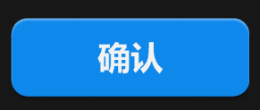

# 主按钮-大-立体



## 1_hover

background-color：品牌 / 提亮

``` css
/* 确认按钮 */

/* Auto layout */
display: flex;
flex-direction: row;
justify-content: center;
align-items: center;
padding: 8px 0px;

width: 116px;
height: 38px;

/* 品牌/常态 */
background: #0F89EC;
/* 立体感-主要按钮 */
box-shadow: 0px 2px 1px rgba(0, 0, 0, 0.2), inset 0px 1px 1px rgba(255, 255, 255, 0.4);
border-radius: 8px;

/* Inside auto layout */
flex: none;
order: 1;
flex-grow: 1;


/* 确认 */

width: 32px;
height: 22px;

/* 通用/按钮文字-大 */
font-family: 'Microsoft YaHei UI';
font-style: normal;
font-weight: 700;
font-size: 16px;
line-height: 22px;
/* identical to box height, or 138% */

/* 亮色/一级 */
color: #F2F2F2;


/* Inside auto layout */
flex: none;
order: 0;
flex-grow: 0;
```

