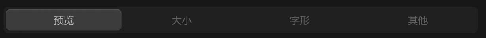

# 分段控制器-文字



## 1_hover-分段

background-color：亮色 / 半透明-3

## 2_选中

滑动动画

``` css
/* 模式切换-按钮容器 */

/* Auto layout */
display: flex;
flex-direction: row;
justify-content: center;
align-items: center;
padding: 4px;
gap: 4px;

width: 712px;
height: 40px;

/* 通用/三级 */
background: #242424;
border-radius: 8px;

/* Inside auto layout */
flex: none;
order: 1;
align-self: stretch;
flex-grow: 0;


/* 预览-按钮 */

/* Auto layout */
display: flex;
flex-direction: row;
justify-content: center;
align-items: center;
padding: 6px;

width: 173px;
height: 32px;

/* 亮色/半透明-1 */
background: rgba(242, 242, 242, 0.18);
/* 立体感-通用 */
box-shadow: 0px 2px 1px rgba(0, 0, 0, 0.2), inset 0px 1px 1px rgba(255, 255, 255, 0.2);
border-radius: 6px;

/* Inside auto layout */
flex: none;
order: 0;
flex-grow: 1;


/* 预览 */

width: 30px;
height: 20px;

/* 通用/按钮文字 */
font-family: 'Microsoft YaHei UI';
font-style: normal;
font-weight: 400;
font-size: 15px;
line-height: 20px;
/* identical to box height, or 133% */

/* 亮色/一级 */
color: #F2F2F2;


/* Inside auto layout */
flex: none;
order: 0;
flex-grow: 0;


/* 大小-按钮 */

/* Auto layout */
display: flex;
flex-direction: row;
justify-content: center;
align-items: center;
padding: 6px;

width: 173px;
height: 32px;

border-radius: 6px;

/* Inside auto layout */
flex: none;
order: 1;
flex-grow: 1;


/* 大小 */

width: 30px;
height: 20px;

/* 通用/按钮文字 */
font-family: 'Microsoft YaHei UI';
font-style: normal;
font-weight: 400;
font-size: 15px;
line-height: 20px;
/* identical to box height, or 133% */

/* 亮色/三级 */
color: #808080;


/* Inside auto layout */
flex: none;
order: 0;
flex-grow: 0;


/* 字形-按钮 */

/* Auto layout */
display: flex;
flex-direction: row;
justify-content: center;
align-items: center;
padding: 6px;

width: 173px;
height: 32px;

border-radius: 6px;

/* Inside auto layout */
flex: none;
order: 2;
flex-grow: 1;


/* 字形 */

width: 30px;
height: 20px;

/* 通用/按钮文字 */
font-family: 'Microsoft YaHei UI';
font-style: normal;
font-weight: 400;
font-size: 15px;
line-height: 20px;
/* identical to box height, or 133% */

/* 亮色/三级 */
color: #808080;


/* Inside auto layout */
flex: none;
order: 0;
flex-grow: 0;


/* 其他-按钮 */

/* Auto layout */
display: flex;
flex-direction: row;
justify-content: center;
align-items: center;
padding: 6px;

width: 173px;
height: 32px;

border-radius: 6px;

/* Inside auto layout */
flex: none;
order: 3;
flex-grow: 1;


/* 其他 */

width: 30px;
height: 20px;

/* 通用/按钮文字 */
font-family: 'Microsoft YaHei UI';
font-style: normal;
font-weight: 400;
font-size: 15px;
line-height: 20px;
/* identical to box height, or 133% */

/* 亮色/三级 */
color: #808080;


/* Inside auto layout */
flex: none;
order: 0;
flex-grow: 0;
```

