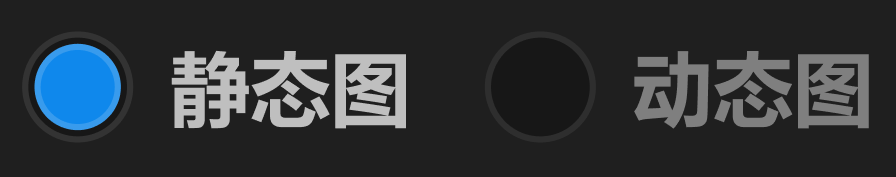

# 单选框



## 1_hover-未选中

border-color：亮色 / 六级

## 2_选中

品牌色圆形icon：弹出动画，过冲效果。

``` css
/* 单选框 */

/* Auto layout */
display: flex;
flex-direction: row;
align-items: flex-start;
padding: 0px;
gap: 12px;

width: 138px;
height: 18px;


/* Inside auto layout */
flex: none;
order: 34;
flex-grow: 0;


/* 静态图 */

/* Auto layout */
display: flex;
flex-direction: row;
align-items: center;
padding: 0px;
gap: 6px;

width: 63px;
height: 18px;


/* Inside auto layout */
flex: none;
order: 0;
flex-grow: 0;


/* 单选框 - 选中 */

box-sizing: border-box;

/* Auto layout */
display: flex;
flex-direction: row;
justify-content: center;
align-items: center;
padding: 2px;

width: 18px;
height: 18px;

/* 通用/一级 */
background: #171717;
/* 通用/六级 */
border: 1px solid #333333;
border-radius: 12px;

/* Inside auto layout */
flex: none;
order: 0;
flex-grow: 0;


/* 选中圆形 */

box-sizing: border-box;

/* Auto layout */
display: flex;
flex-direction: row;
justify-content: center;
align-items: center;
padding: 0px;

width: 14px;
height: 14px;

/* 品牌/常态 */
background: #0F89EC;
/* 亮色/半透明-1 */
border: 1px solid rgba(242, 242, 242, 0.18);
border-radius: 15px;

/* Inside auto layout */
flex: none;
order: 0;
flex-grow: 0;


/* 标题 */

width: 39px;
height: 18px;

/* 通用/正文-加粗 */
font-family: 'Microsoft YaHei UI';
font-style: normal;
font-weight: 700;
font-size: 13px;
line-height: 18px;
/* identical to box height, or 138% */
display: flex;
align-items: center;

/* 亮色/二级 */
color: #BFBFBF;


/* Inside auto layout */
flex: none;
order: 1;
flex-grow: 0;


/* 动态图 */

/* Auto layout */
display: flex;
flex-direction: row;
align-items: center;
padding: 0px;
gap: 6px;

width: 63px;
height: 18px;


/* Inside auto layout */
flex: none;
order: 1;
flex-grow: 0;


/* 单选框 - 未选中 */

box-sizing: border-box;

/* Auto layout */
display: flex;
flex-direction: row;
justify-content: center;
align-items: center;
padding: 2px;

width: 18px;
height: 18px;

/* 通用/一级 */
background: #171717;
/* 通用/五级 */
border: 1px solid #2E2E2E;
border-radius: 12px;

/* Inside auto layout */
flex: none;
order: 0;
flex-grow: 0;


/* 选中圆形 */

box-sizing: border-box;

/* Auto layout */
display: flex;
flex-direction: row;
justify-content: center;
align-items: center;
padding: 0px;

display: none;
width: 16px;
height: 16px;

/* 品牌色/常态 */
background: #0A8079;
opacity: 0;
/* 线条和交互/亮 - 选中 */
border: 1px solid rgba(230, 251, 232, 0.1412);
border-radius: 15px;

/* Inside auto layout */
flex: none;
order: 0;
flex-grow: 0;


/* 标题 */

width: 39px;
height: 18px;

/* 通用/正文-加粗 */
font-family: 'Microsoft YaHei UI';
font-style: normal;
font-weight: 700;
font-size: 13px;
line-height: 18px;
/* identical to box height, or 138% */
display: flex;
align-items: center;

/* 亮色/三级 */
color: #808080;


/* Inside auto layout */
flex: none;
order: 1;
flex-grow: 0;
```

