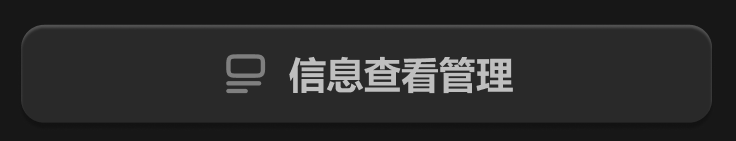

# 图标+文字-立体



## 1_hover

background-color：通用-六级

``` css
/* 信息查看管理 */

/* Auto layout */
display: flex;
flex-direction: row;
justify-content: center;
align-items: center;
padding: 8px 0px;
gap: 6px;

width: 240px;
height: 34px;

/* 通用/四级 */
background: #292929;
/* 立体感-通用 */
box-shadow: 0px 2px 1px rgba(0, 0, 0, 0.2), inset 0px 1px 1px rgba(255, 255, 255, 0.2);
border-radius: 8px;

/* Inside auto layout */
flex: none;
order: 0;
align-self: stretch;
flex-grow: 0;


/* 信息查看管理-icon */

/* Auto layout */
display: flex;
flex-direction: row;
justify-content: center;
align-items: center;
padding: 0px;

width: 18px;
height: 18px;


/* Inside auto layout */
flex: none;
order: 0;
flex-grow: 0;


/* svg */

width: 12px;
height: 12px;


/* Inside auto layout */
flex: none;
order: 0;
flex-grow: 0;


/* Vector */

position: absolute;
left: 16.67%;
right: 24.07%;
top: 68.52%;
bottom: 31.48%;

/* 亮色/三级 */
border: 1.5px solid #808080;


/* Vector */

position: absolute;
left: 16.67%;
right: 50%;
top: 83.33%;
bottom: 16.67%;

/* 亮色/三级 */
border: 1.5px solid #808080;


/* Rectangle 2290 */

position: absolute;
left: 16.67%;
right: 16.67%;
top: 16.67%;
bottom: 46.3%;

/* 亮色/三级 */
border: 1.5px solid #808080;


/* 信息查看管理 */

width: 78px;
height: 18px;

/* 通用/正文-加粗 */
font-family: 'Microsoft YaHei UI';
font-style: normal;
font-weight: 700;
font-size: 13px;
line-height: 18px;
/* identical to box height, or 138% */
display: flex;
align-items: center;

/* 亮色/二级 */
color: #BFBFBF;


/* Inside auto layout */
flex: none;
order: 1;
flex-grow: 0;
```