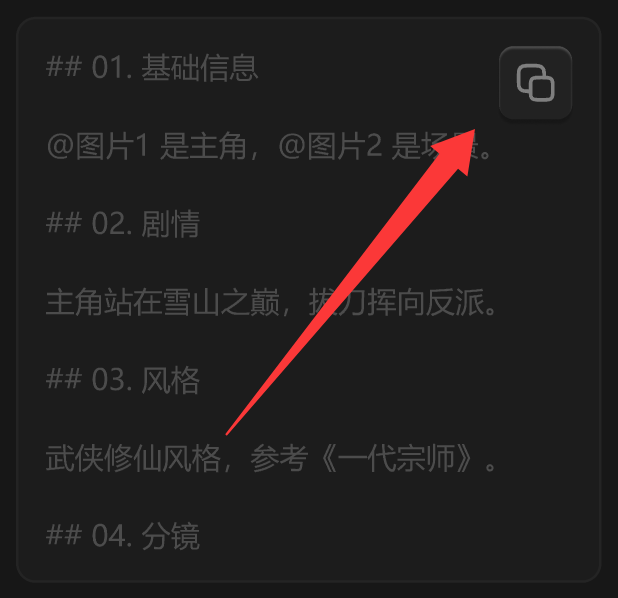

# 图标按钮-立体-半透明



## 1_hover

background-color：通用 / 四级

``` css
/* 复制提示词-按钮 */

/* Auto layout */
display: flex;
flex-direction: row;
justify-content: center;
align-items: center;
padding: 6px;

position: absolute;
width: 30px;
height: 30px;
left: 198px;
top: 12px;

/* 通用/半透明-2 */
background: rgba(41, 41, 41, 0.5);
/* 立体感-通用 */
box-shadow: 0px 2px 1px rgba(0, 0, 0, 0.2), inset 0px 1px 1px rgba(255, 255, 255, 0.2);
border-radius: 6px;

/* Inside auto layout */
flex: none;
order: 1;
flex-grow: 0;
z-index: 1;


/* 复制-icon */

/* Auto layout */
display: flex;
flex-direction: row;
justify-content: center;
align-items: center;
padding: 0px;

width: 18px;
height: 18px;


/* Inside auto layout */
flex: none;
order: 0;
flex-grow: 0;


/* svg */

width: 14px;
height: 14px;


/* Inside auto layout */
flex: none;
order: 0;
flex-grow: 0;


/* Rectangle 1703 */

position: absolute;
left: 38.33%;
right: 11.11%;
top: 38.33%;
bottom: 11.11%;

/* 亮色/三级 */
border: 1.5px solid #808080;
border-radius: 3px;


/* Rectangle 1704 */

position: absolute;
left: 11.11%;
right: 30.56%;
top: 11.11%;
bottom: 30.56%;

/* 亮色/三级 */
border: 1.5px solid #808080;
```

