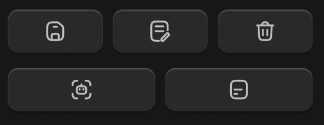

# 图标按钮-立体



## 1_hover

background-color：通用 / 六级

``` css
/* 指定提示词文件-按钮 */

/* Auto layout */
display: flex;
flex-direction: row;
justify-content: center;
align-items: center;
padding: 8px 0px;

width: 116px;
height: 34px;

/* 通用/四级 */
background: #292929;
/* 立体感-通用 */
box-shadow: 0px 2px 1px rgba(0, 0, 0, 0.2), inset 0px 1px 1px rgba(255, 255, 255, 0.2);
border-radius: 8px;

/* Inside auto layout */
flex: none;
order: 1;
flex-grow: 1;


/* 指定提示词文件-icon */

/* Auto layout */
display: flex;
flex-direction: row;
justify-content: center;
align-items: center;
padding: 0px;

width: 18px;
height: 18px;


/* Inside auto layout */
flex: none;
order: 0;
flex-grow: 0;


/* svg */

width: 12.6px;
height: 14px;


/* Inside auto layout */
flex: none;
order: 0;
flex-grow: 0;


/* Rectangle 17754 */

position: absolute;
left: 15%;
right: 15%;
top: 11.11%;
bottom: 11.11%;

/* 亮色/二级 */
border: 1.5px solid #BFBFBF;


/* Vector */

position: absolute;
left: 30.56%;
right: 38.33%;
top: 50%;
bottom: 30.56%;

/* 亮色/二级 */
border: 1.5px solid #BFBFBF;
```

