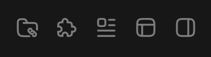

# 图标按钮-通用



## 1_hover

background-color：亮色 / 半透明-3

text-color：亮色 / 二级

``` css
/* 收起侧边栏-按钮 */

/* Auto layout */
display: flex;
flex-direction: row;
justify-content: center;
align-items: center;
padding: 6px;

width: 30px;
height: 30px;

border-radius: 6px;

/* Inside auto layout */
flex: none;
order: 0;
flex-grow: 0;


/* 收起侧边栏-icon */

/* Auto layout */
display: flex;
flex-direction: row;
justify-content: center;
align-items: center;
padding: 0px;

width: 18px;
height: 18px;


/* Inside auto layout */
flex: none;
order: 0;
flex-grow: 0;


/* svg */

width: 14px;
height: 14px;


/* Inside auto layout */
flex: none;
order: 0;
flex-grow: 0;


/* Vector 4065 */

position: absolute;
left: 11.11%;
right: 11.11%;
top: 11.11%;
bottom: 11.11%;

/* 亮色/三级 */
border: 1.5px solid #808080;
transform: rotate(-180deg);


/* Vector 4066 */

position: absolute;
left: 37.72%;
right: 62.28%;
top: 11.11%;
bottom: 11.11%;

/* 亮色/三级 */
border: 1.5px solid #808080;
border-radius: 5px;
transform: rotate(-180deg);
```

