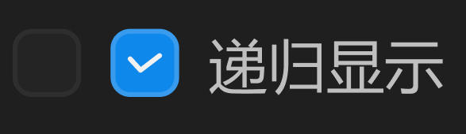

# 复选框



设计时是按全量设计的，非选中和选中态，按需出现。

## 1_hover-未选中

border-color：亮色 / 六级

## 2_选中

icon：弹出动画，过冲效果。

background-color and border-color：透明度过渡动画。

``` css
/* 递归显示-按钮 */

/* Auto layout */
display: flex;
flex-direction: row;
align-items: center;
padding: 0px;
gap: 6px;

width: 88px;
height: 16px;


/* Inside auto layout */
flex: none;
order: 33;
flex-grow: 0;


/* 复选框 */

box-sizing: border-box;

/* Auto layout */
display: flex;
flex-direction: row;
justify-content: center;
align-items: center;
padding: 0px;

width: 14px;
height: 14px;

/* 通用/三级 */
background: #242424;
/* 通用/五级 */
border: 1px solid #2E2E2E;
border-radius: 4px;

/* Inside auto layout */
flex: none;
order: 0;
flex-grow: 0;


/* 复选框 */

box-sizing: border-box;

/* Auto layout */
display: flex;
flex-direction: row;
justify-content: center;
align-items: center;
padding: 0px;

width: 14px;
height: 14px;

/* 品牌/常态 */
background: #0F89EC;
/* 亮色/半透明-1 */
border: 1px solid rgba(242, 242, 242, 0.18);
border-radius: 4px;

/* Inside auto layout */
flex: none;
order: 1;
flex-grow: 0;


/* 对勾-极小-icon */

/* Auto layout */
display: flex;
flex-direction: column;
justify-content: center;
align-items: center;
padding: 0px;

width: 10px;
height: 10px;


/* Inside auto layout */
flex: none;
order: 0;
flex-grow: 0;


/* Vector 9891 */

width: 6px;
height: 3px;

/* 亮色/一级 */
border: 1px solid #F2F2F2;

/* Inside auto layout */
flex: none;
order: 0;
flex-grow: 0;


/* 递归显示 */

width: 48px;
height: 16px;

/* 通用/次要文字 */
font-family: 'Microsoft YaHei UI';
font-style: normal;
font-weight: 400;
font-size: 12px;
line-height: 16px;
/* identical to box height, or 133% */

/* 亮色/二级 */
color: #BFBFBF;


/* Inside auto layout */
flex: none;
order: 2;
flex-grow: 0;
```

