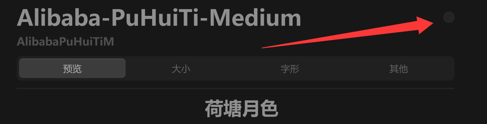
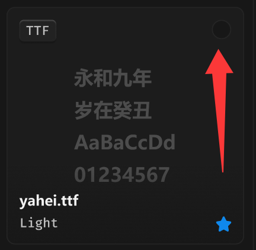

# 字体安装按钮





## 1_选中

background-color：品牌色 / 常态

border-color：亮色 / 半透明-1

``` css
/* 安装-按钮 */

box-sizing: border-box;

/* Auto layout */
display: flex;
flex-direction: row;
justify-content: center;
align-items: center;
padding: 0px;

width: 18px;
height: 18px;

/* 通用/四级 */
background: #292929;
/* 通用/六级 */
border: 1px solid #333333;
border-radius: 99px;

/* Inside auto layout */
flex: none;
order: 1;
flex-grow: 0;
```

