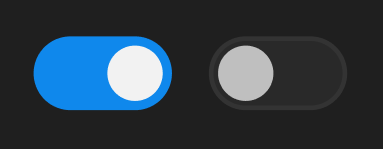

# 开关按钮



开关横移动画。

``` css
/* 开关按钮 */

/* Auto layout */
display: flex;
flex-direction: row;
align-items: center;
padding: 0px;
gap: 8px;

width: 68px;
height: 16px;


/* Inside auto layout */
flex: none;
order: 35;
flex-grow: 0;


/* 切换开关-开 */

/* Auto layout */
display: flex;
flex-direction: row;
justify-content: flex-end;
align-items: center;
padding: 2px;
gap: 2px;

width: 30px;
height: 16px;

/* 品牌/常态 */
background: #0F89EC;
border-radius: 15px;

/* Inside auto layout */
flex: none;
order: 0;
flex-grow: 0;


/* 圆形按钮 */

width: 12px;
height: 12px;

/* 亮色/一级 */
background: #F2F2F2;

/* Inside auto layout */
flex: none;
order: 0;
flex-grow: 0;


/* 切换开关-开 */

box-sizing: border-box;

/* Auto layout */
display: flex;
flex-direction: row;
align-items: center;
padding: 2px;
gap: 2px;

width: 30px;
height: 16px;

/* 通用/四级 */
background: #292929;
/* 通用/六级 */
border: 1px solid #333333;
border-radius: 15px;

/* Inside auto layout */
flex: none;
order: 1;
flex-grow: 0;


/* 圆形按钮 */

width: 12px;
height: 12px;

/* 亮色/二级 */
background: #BFBFBF;

/* Inside auto layout */
flex: none;
order: 0;
flex-grow: 0;
```

