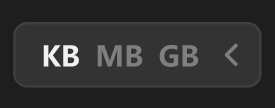

# 下拉按钮-横向



常态下只显示一个，箭头朝右，点击箭头展开选项，选中项高亮。

## 1_hover-展开箭头

icon-color：亮色 / 二级

## 2_选中

text-color：亮色 / 一级

``` css
/* 单位下拉菜单 */

box-sizing: border-box;

/* Auto layout */
display: flex;
flex-direction: row;
align-items: center;
padding: 6px 6px 6px 12px;
gap: 6px;

width: 106px;
height: 28px;

/* 通用/六级 */
background: #333333;
/* 亮色/半透明-3 */
border: 1px solid rgba(242, 242, 242, 0.06);
border-radius: 6px;

/* Inside auto layout */
flex: none;
order: 0;
flex-grow: 0;


/* KB */

width: 17px;
height: 16px;

/* 通用/次要文字-加粗 */
font-family: 'Microsoft YaHei UI';
font-style: normal;
font-weight: 700;
font-size: 12px;
line-height: 16px;
/* identical to box height, or 133% */

/* 亮色/一级 */
color: #F2F2F2;


/* Inside auto layout */
flex: none;
order: 0;
flex-grow: 0;


/* MB */

width: 21px;
height: 16px;

/* 通用/次要文字-加粗 */
font-family: 'Microsoft YaHei UI';
font-style: normal;
font-weight: 700;
font-size: 12px;
line-height: 16px;
/* identical to box height, or 133% */

/* 亮色/三级 */
color: #808080;


/* Inside auto layout */
flex: none;
order: 1;
flex-grow: 0;


/* GB */

width: 18px;
height: 16px;

/* 通用/次要文字-加粗 */
font-family: 'Microsoft YaHei UI';
font-style: normal;
font-weight: 700;
font-size: 12px;
line-height: 16px;
/* identical to box height, or 133% */

/* 亮色/三级 */
color: #808080;


/* Inside auto layout */
flex: none;
order: 2;
flex-grow: 0;


/* 展开按钮-icon */

/* Auto layout */
display: flex;
flex-direction: column;
justify-content: center;
align-items: center;
padding: 0px;

width: 14px;
height: 14px;

transform: rotate(90deg);

/* Inside auto layout */
flex: none;
order: 3;
flex-grow: 0;


/* svg */

width: 8px;
height: 4px;

transform: rotate(90deg);

/* Inside auto layout */
flex: none;
order: 0;
flex-grow: 0;


/* Vector */

position: absolute;
left: 35.71%;
right: 35.71%;
top: 21.43%;
bottom: 21.43%;

/* 亮色/三级 */
border: 1.5px solid #808080;
transform: matrix(1, 0, 0, -1, 0, 0);
```

