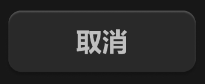

# 文字按钮-大-底色装饰



## 1_hover

background-color：通用 / 六级

``` css
/* 取消按钮 */

/* Auto layout */
display: flex;
flex-direction: row;
justify-content: center;
align-items: center;
padding: 8px 0px;

width: 116px;
height: 38px;

/* 通用/四级 */
background: #292929;
box-shadow: 0px 2px 2px rgba(0, 0, 0, 0.2), inset 0px 1px 1px rgba(255, 255, 255, 0.2);
border-radius: 8px;

/* Inside auto layout */
flex: none;
order: 0;
flex-grow: 1;


/* 取消 */

width: 32px;
height: 22px;

/* 通用/按钮文字-大 */
font-family: 'Microsoft YaHei UI';
font-style: normal;
font-weight: 700;
font-size: 16px;
line-height: 22px;
/* identical to box height, or 138% */

/* 亮色/二级 */
color: #BFBFBF;


/* Inside auto layout */
flex: none;
order: 0;
flex-grow: 0;

```

