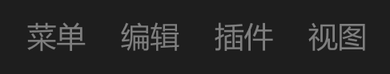

# 文字按钮



## 1_hover

background-color：亮色 / 半透明-3

text-color：亮色 / 二级

``` css
/* 菜单-按钮 */

/* Auto layout */
display: flex;
flex-direction: row;
justify-content: center;
align-items: center;
padding: 4px 8px;

width: 46px;
height: 28px;

border-radius: 6px;

/* Inside auto layout */
flex: none;
order: 1;
flex-grow: 0;


/* 菜单 */

width: 30px;
height: 20px;

/* 通用/按钮文字 */
font-family: 'Microsoft YaHei UI';
font-style: normal;
font-weight: 400;
font-size: 15px;
line-height: 20px;
/* identical to box height, or 133% */

/* 亮色/三级 */
color: #808080;


/* Inside auto layout */
flex: none;
order: 0;
flex-grow: 0;
```

