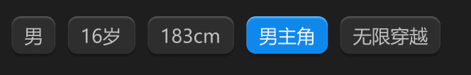

# 标签按钮-小-立体



## 1_hover

background-color：通用-六级

## 2_选中

background-color：品牌色 / 常态

text-color：亮色 / 一级

效果：立体感-主要按钮

``` css
/* 标签 */

/* Auto layout */
display: flex;
flex-direction: row;
justify-content: center;
align-items: center;
padding: 4px 8px;

width: 64px;
height: 24px;

/* 通用/五级 */
background: #2E2E2E;
/* 立体感-通用 */
box-shadow: 0px 2px 1px rgba(0, 0, 0, 0.2), inset 0px 1px 1px rgba(255, 255, 255, 0.2);
border-radius: 6px;

/* Inside auto layout */
flex: none;
order: 4;
flex-grow: 0;


/* 无限穿越 */

width: 48px;
height: 16px;

/* 通用/次要文字 */
font-family: 'Microsoft YaHei UI';
font-style: normal;
font-weight: 400;
font-size: 12px;
line-height: 16px;
/* identical to box height, or 133% */
display: flex;
align-items: center;

/* 亮色/二级 */
color: #BFBFBF;


/* Inside auto layout */
flex: none;
order: 0;
flex-grow: 0;
```

