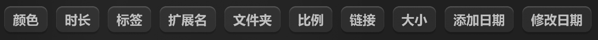

# 标签按钮-立体



## 1_hover

background-color：亮色 / 半透明-2

## 2_选中

background-color：亮色 / 半透明-1

text-color：亮色 / 一级

``` css
/* 扩展名 */

/* Auto layout */
display: flex;
flex-direction: row;
justify-content: center;
align-items: center;
padding: 4px 8px;

width: 52px;
height: 24px;

/* 亮色/半透明-3 */
background: rgba(242, 242, 242, 0.06);
/* 立体感-通用 */
box-shadow: 0px 2px 1px rgba(0, 0, 0, 0.2), inset 0px 1px 1px rgba(255, 255, 255, 0.2);
border-radius: 6px;

/* Inside auto layout */
flex: none;
order: 3;
flex-grow: 0;


/* 扩展名 */

width: 36px;
height: 16px;

/* 通用/次要文字-加粗 */
font-family: 'Microsoft YaHei UI';
font-style: normal;
font-weight: 700;
font-size: 12px;
line-height: 16px;
/* identical to box height, or 133% */

/* 亮色/二级 */
color: #BFBFBF;


/* Inside auto layout */
flex: none;
order: 0;
flex-grow: 0;
```

