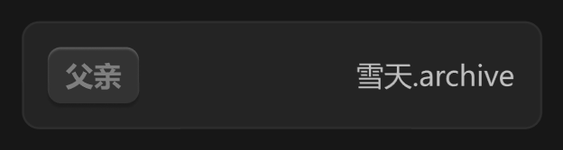

# 链接关系 item



## 1_hover-item

background-color：通用 / 四级

border-color：通用 / 六级

关闭按钮常态不显示，不产生视觉噪音，hover 时右至左滑入

## 2_hover-关闭按钮

icon-color：亮色 / 二级

## 3_hover-关系标签

background-color：亮色 / 半透明-2，输入指针

## 4_选中进入输入状态-关系标签

去掉：立体感-通用

background-color：通用 / 二级

border-color：亮色 / 半透明-1

展开宽度，增加输入空间

``` css
/* 音频卡片-列表 */

/* Auto layout */
display: flex;
flex-direction: column;
justify-content: center;
align-items: flex-start;
padding: 0px;
gap: 8px;

width: 240px;
height: 46px;


/* Inside auto layout */
flex: none;
order: 1;
align-self: stretch;
flex-grow: 0;


/* 音频卡片 */

box-sizing: border-box;

/* Auto layout */
display: flex;
flex-direction: row;
justify-content: space-between;
align-items: center;
padding: 12px;
gap: 48px;

width: 240px;
height: 46px;

/* 通用/三级 */
background: #242424;
/* 通用/五级 */
border: 1px solid #2E2E2E;
border-radius: 8px;

/* Inside auto layout */
flex: none;
order: 0;
align-self: stretch;
flex-grow: 0;


/* 图标 + 标题 */

/* Auto layout */
display: flex;
flex-direction: row;
justify-content: center;
align-items: center;
padding: 0px;
gap: 6px;

width: 86px;
height: 22px;


/* Inside auto layout */
flex: none;
order: 0;
flex-grow: 0;


/* 音频卡片-播放 */

box-sizing: border-box;

/* Auto layout */
display: flex;
flex-direction: row;
justify-content: center;
align-items: center;
padding: 4px 4px 4px 6px;

width: 22px;
height: 22px;

/* 品牌/常态 */
background: #0F89EC;
/* 亮色/半透明-1 */
border: 1px solid rgba(242, 242, 242, 0.18);
border-radius: 15px;

/* Inside auto layout */
flex: none;
order: 0;
flex-grow: 0;


/* Vector */

width: 7px;
height: 9px;

/* 亮色/一级 */
background: #F2F2F2;

/* Inside auto layout */
flex: none;
order: 0;
flex-grow: 0;


/* 音频卡片-暂停 */

box-sizing: border-box;

/* Auto layout */
display: flex;
flex-direction: row;
justify-content: center;
align-items: center;
padding: 4px;

display: none;
width: 22px;
height: 22px;

/* 品牌/常态 */
background: #0F89EC;
/* 亮色/半透明-1 */
border: 1px solid rgba(242, 242, 242, 0.18);
border-radius: 15px;

/* Inside auto layout */
flex: none;
order: 1;
flex-grow: 0;


/* svg */

width: 6px;
height: 9px;


/* Inside auto layout */
flex: none;
order: 0;
flex-grow: 0;


/* Rectangle 17758 */

position: absolute;
width: 2px;
height: 9px;
left: 8px;
top: 6.5px;

/* 亮色/一级 */
background: #F2F2F2;
border-radius: 0.3px;


/* Rectangle 17759 */

position: absolute;
width: 2px;
height: 9px;
left: 12px;
top: 6.5px;

/* 亮色/一级 */
background: #F2F2F2;
border-radius: 0.3px;


/* 雪牧-常态 */

width: 58px;
height: 18px;

/* 通用/正文 */
font-family: 'Microsoft YaHei UI';
font-style: normal;
font-weight: 400;
font-size: 13px;
line-height: 18px;
/* identical to box height, or 138% */

/* 亮色/二级 */
color: #BFBFBF;


/* Inside auto layout */
flex: none;
order: 2;
flex-grow: 0;


/* 链接音频-波形装饰-icon */

width: 49px;
height: 18px;

/* 亮色/半透明-2 */
background: rgba(242, 242, 242, 0.14);

/* Inside auto layout */
flex: none;
order: 1;
flex-grow: 0;

```

